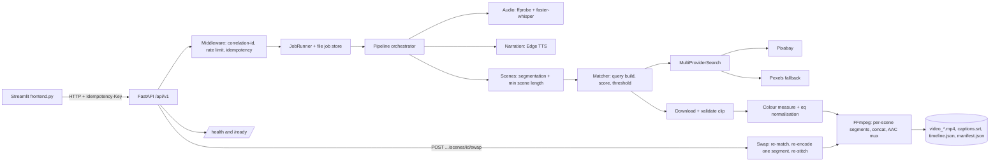

# AI B-roll Studio

Turn a **script** or an **uploaded narration audio file** into a finished, captioned MP4 with B-roll footage matched to
what each scene says. FastAPI backend, Streamlit frontend, FFmpeg rendering, Pixabay (or Pexels) footage.

> **Honesty notes up front**
> * Footage matching defaults to a **metadata/text fallback** (clip titles and tags vs. the scene analysis). No vision
>   model looks at video frames unless you install the optional OpenCLIP verifier. Every scene's record says which method
>   scored it, and the manifest says whether any visual AI verification happened.
> * Licence fields describe the **provider's published policy**, not a per-clip legal check. See *Licensing*.
> * Mock TTS / mock transcription never pass as real: they are refused unless you opt in, and then labelled as placeholders.

## Architecture

```
frontend.py (Streamlit)  ──HTTP──►  backend/app (FastAPI)
                                      ├─ api/v1/endpoints/jobs.py      POST /jobs, GET /jobs/{id}, file downloads   (NEW)
                                      ├─ api/v1/endpoints/*            legacy per-step endpoints (scripts, broll, audio, captions, video)
                                      └─ pipeline/                     (NEW, dependency-light core)
                                           orchestrator.py   validate → scenes/narration → match → download → captions → render → validate → JSON
                                           narration.py      Edge TTS (real) / placeholder tones (mock, flagged)
                                           transcription.py  faster-whisper (real) / canned mock (flagged)
                                           alignment.py      word timing, script↔audio reconciliation, scene building
                                           scene_analysis.py subject/action/setting/objects → visual description + ranked queries
                                           matching.py       multi-query search, filter, score, threshold, retry, disclosed fallback
                                           ranking.py        scoring formula + candidate filters
                                           visual.py         replaceable visual verifier (none | OpenCLIP)
                                           captions.py       word-timed cues, SRT writer, strict SRT validator
                                           renderer.py       FFmpeg (H.264 + AAC, 30 fps, yuv420p), subject-aware cropping
                                           validation.py     ffprobe + blackdetect/freezedetect checks on the final MP4
                                           artifacts.py      timeline.json / manifest.json builders + validators
                                           jobs.py           file-backed job store + background thread runner
```

Each job lives in `backend/storage/jobs/<job_id>/`:

| File | Content |
|---|---|
| `video.mp4` | Final video (H.264/AAC) |
| `narration.mp3` (or the uploaded format) | Generated narration, or your uploaded audio |
| `captions.srt` | Synchronized captions |
| `timeline.json` | Per-scene text, timing, visual description, queries, chosen clip, licence, scores, warnings |
| `manifest.json` | Job-level record: providers/models, methods, settings, durations, cost, licences, warnings, validation |
| `clips/` | Downloaded footage used by the job |
| `job.json` | Status/progress |

Representative outputs: `examples/` (read `examples/README.md` first: they come from the test harness with test doubles).

## Prerequisites

* Python 3.11+ (developed against 3.12)
* **FFmpeg and FFprobe on PATH** (`ffmpeg -version`). On Windows: `winget install Gyan.FFmpeg`, then reopen the terminal.
  The build needs `libx264`, `aac` and the `subtitles` filter (libass), which standard builds include.
* A free **Pixabay API key** (https://pixabay.com/api/docs/) for footage.
* Internet access for: Edge TTS narration, Pixabay search/downloads, first-time Whisper model download.

## Installation (Windows PowerShell / VS Code)

```powershell
cd ai_broll_studio_phase7_final
py -m venv .venv
.\.venv\Scripts\Activate.ps1
py -m pip install -r backend\requirements-dev.txt
py -m pip install -r requirements-frontend.txt
Copy-Item backend\.env.example backend\.env
notepad backend\.env        # set PIXABAY_API_KEY
```

`faster-whisper` (in requirements.txt) is only needed for uploaded-audio mode; the first transcription downloads the
Whisper model (`WHISPER_MODEL_SIZE=base` ≈ 140 MB). If `Activate.ps1` is blocked:
`Set-ExecutionPolicy -Scope CurrentUser RemoteSigned`.

In VS Code choose the interpreter `.venv\Scripts\python.exe` (Ctrl+Shift+P → *Python: Select Interpreter*).

## Configuration

All settings are environment variables / `backend/.env` (template: `backend/.env.example`). Key ones:

| Variable | Default | Meaning |
|---|---|---|
| `TTS_PROVIDER` | `edge` | `edge` = real narration; `mock` = placeholder tones (needs `ALLOW_MOCK_PROVIDERS=true`) |
| `TRANSCRIPTION_PROVIDER` | `whisper` | `whisper` = real local STT; `mock` = canned text (needs `ALLOW_MOCK_PROVIDERS=true`) |
| `FOOTAGE_PROVIDER` | `pixabay` | `pixabay` or `pexels` (`mock` cannot be rendered) |
| `PIXABAY_API_KEY` / `PEXELS_API_KEY` | – | secrets; never commit `.env` |
| `TTS_DEFAULT_VOICE`, `DEFAULT_LANGUAGE` | `en-US-AriaNeural`, `en` | any Edge voice short name works (`edge-tts --list-voices`) |
| `MATCH_THRESHOLD` | `0.45` | minimum relevance for a clip to count as matched |
| `MATCH_FALLBACK_POLICY` | `best_available` | `fail` aborts the job when a scene cannot be matched |
| `VISUAL_VERIFIER` | `metadata` | `clip` enables OpenCLIP frame analysis (install `backend\requirements-optional.txt`) |
| `STORAGE_ROOT` | `./storage` | relative paths resolve against `backend/` |
| `MAX_AUDIO_FILE_SIZE_MB`, `MAX_AUDIO_SECONDS` | `50`, `900` | upload limits |

Scoring weights, caption line length, fps, CRF etc. live in `backend/app/pipeline/config.py` (`PipelineSettings`).

## Running

Backend (terminal 1, from the project root):
```powershell
cd backend
$env:PYTHONPATH = "."
py -m uvicorn app.main:app --host 127.0.0.1 --port 8000 --reload
```
API docs: http://127.0.0.1:8000/api/v1/docs

Frontend (terminal 2, from the project root):
```powershell
.\.venv\Scripts\Activate.ps1
py -m streamlit run frontend.py
```
If the backend is elsewhere: `$env:BROLL_API_URL = "http://host:8000/api/v1"` before starting Streamlit.

## Generate a video

### From a script alone
1. Open **One-Click Workflow**, choose **Script only**, paste the script.
2. Pick narration voice, caption options; aspect ratio and footage provider are in the sidebar.
3. Click **Generate Video**. The backend splits the script into scenes (no text is lost or rewritten), generates narration
   per scene with Edge TTS, joins it, derives captions from the TTS word boundaries, matches footage, renders, validates.
4. Watch the video, play the audio, download MP4 / SRT / `timeline.json` / `manifest.json`, read the warnings.

### From uploaded audio
1. Choose **Upload audio**, upload MP3/WAV/M4A (AAC/OGG/FLAC also accepted if your FFmpeg decodes them).
2. Optionally paste the script. **Rule when both are given:** the uploaded audio is the source of truth for timing. The
   audio is transcribed; if the script is ≥ 80 % similar to the transcript, the *script's wording* is used with the
   *audio's timing* (differences < 98 % are reported as warnings). If it is less similar, the transcript of the audio is used,
   the script is ignored and the mismatch is reported in the warnings and manifest.
3. Click **Generate Video**. Scenes are aligned to real speech times and tile the audio exactly.

### Via the API
```powershell
# script only
curl.exe -X POST http://127.0.0.1:8000/api/v1/jobs -F "script=Sea turtles swim through the ocean." -F "aspect_ratio=9:16"
# uploaded audio
curl.exe -X POST http://127.0.0.1:8000/api/v1/jobs -F "audio=@C:\path\talk.mp3" -F "aspect_ratio=16:9"
# poll, then download
curl.exe http://127.0.0.1:8000/api/v1/jobs/<job_id>
curl.exe -o video.mp4 http://127.0.0.1:8000/api/v1/jobs/<job_id>/files/video.mp4
```
Errors are structured: `{"detail": {"code": "invalid_audio", "message": "...", "details": {...}}}`.

## How matching works

1. **Understand the scene** (`scene_analysis.py`, `lexicon.py`): subject (+ role synonyms), action, setting, objects, a *visual
   description* and 5-9 queries (<= 8 words, never repeated). A second coordinated action is kept ("examines a patient **and checks
   the blood pressure**"). A curated **activity lexicon** (~25 frames: farming, healthcare, coding, teaching, science, travel,
   cooking, ...) adds, per activity: *action terms* that prove the action, *instrument terms* (cuff, beaker, camera) that also prove
   it, *foil terms* (related-but-different actions: harvesting vs watering, consultation vs blood-pressure), and alternative search
   phrasings. It is English-only and rule-based, **not an LLM**; extend `FRAMES` for your domain. Scenes matching no frame are scored by
   weighted coverage without gates. `LLMSceneAnalyzer` still accepts any `complete(prompt)` callable.
2. **Retrieve** up to 12 candidates per query. Alternate phrasings are tried until a fresh clip scores >= `early_stop_score` (0.62)
   or `max_query_attempts` is reached.
3. **Filter**: duplicates, missing/invalid URL, non-HTTPS / off-allow-list hosts, too short, too low resolution, not commercial,
   flagged AI-generated.
4. **Score** (all components 0-1, renormalised over the elements the scene actually has):
   text = `subject 0.30 + action 0.30 + object 0.25 + setting 0.15` (phrase coverage in title/tags: contiguous phrase 1.0, scattered
   0.75, partial <= 0.5; an *inferred* setting counts half). A foil with no action evidence subtracts 0.10; avoid-terms 0.15.
   final = `(0.35 text + 0.10 technical x (0.5 + 0.5 text)) / 0.45` - technical fit (aspect, duration, resolution) cannot rescue an
   irrelevant clip. With a visual verifier: `visual 0.55 / text 0.35 / technical 0.10`.
5. **Gates** (only for scenes with a known activity frame): a clip is capped just below the threshold when it (a) matches only the
   subject/setting but nothing evidences the action or an instrument, or (b) shows a foil activity without action evidence. A passive
   target (the Eiffel Tower, tomato plants) raises the score but never proves the action. With frames inspected, a clip whose frames
   look more like a foil than the scene is capped the same way.
6. **Thresholds and labels** (`MATCH_THRESHOLD` 0.45, `MATCH_REVIEW_FLOOR` 0.30, `MATCH_HIGH_CONFIDENCE` 0.70). These are
   *uncalibrated relevance rankings, not probabilities*; the UI never shows a percentage.
   * **High**: passed, score >= 0.70 and action/instrument evidence (or frames checked) - **Medium**: passed - **Low**: below threshold.
7. **Policy** (`MATCH_FALLBACK_POLICY`), when nothing passes:
   * `review` (default): best clip with score >= floor is used and flagged **needs review**; below the floor the scene is
     **unmatched** and shows a plain dark placeholder while narration plays. The rest of the video is still produced.
     If *no* scene matches there is nothing to render and the job fails with per-scene queries and reasons.
   * `best_available` (legacy): always use the best clip, however poor, disclosed. `fail`: any unmatched scene fails the job.
8. **Download with fallback**: the chosen clip is downloaded and validated (HTTP, size, container, FFprobe, decode). On failure the next
   *passing* candidate is tried (up to `MAX_DOWNLOAD_ALTERNATES`); a clip that looks like footage already used in another scene
   (3-frame dHash distance <= `DUPLICATE_HASH_DISTANCE`) is skipped while alternatives exist, else reused and disclosed. If every
   candidate fails the scene becomes unmatched - never a fake match. Each attempt and its reason are in `download_attempts`.

### Optional visual verification
`VISUAL_VERIFIER=clip` samples 3 frames per shortlisted clip and compares them with the scene's *positive* prompts and with *foil*
prompts. Requires `pip install open_clip_torch torch pillow` and model weights (downloaded on first use). If unavailable it is
reported in the manifest/diagnostics and matching continues on metadata; scores are never invented. **The contrastive logic is
unit-tested with a fake embedding backend on real extracted frames; it has not been run with real OpenCLIP weights in this repo's tests.**

## Interface

`frontend.py` (Streamlit) + `theme.css` + `.streamlit/config.toml` (dark base theme) + `ui_helpers.py` (pure presentation logic).
Header (backend/provider status, settings) -> **Studio**: input workspace, live progress (stages, elapsed time, scene n of m),
result workspace (player, duration/resolution, matched count, downloads), proportional scene timeline, filterable scene review
(thumbnail, status, High/Medium/Low, one-line reason, per-scene details) and a collapsed **Generation details** panel (notices,
per-scene decisions, providers and limits, raw manifest). The older step pages live under *Tools*.
Short status lines come from `manifest.diagnostics.summary`; full, deduplicated items are in `manifest.diagnostics.items`.
The page type scale is 30/20/15/14/12 px. **Do not** set `font-family` on bare `span`/`div` in CSS: Streamlit draws its icons as
ligature text in the Material font and overriding it prints names like `keyboard_arrow_right` over labels (this was the original bug).

Reading `timeline.json` / `manifest.json`: each scene has `match_status` (`matched`, `fallback_low_confidence` = needs review,
`unmatched`, `no_candidates`), `placeholder`, `relevance` (`score`, `label`, `evidence`, `gated`, `visual_verified`), `download_attempts`,
`used_alternate`, `thumbnail`. `manifest.matching` has counts incl. `scenes_needs_review` / `scenes_unmatched`.

## Captions

Script-only: Edge TTS word boundaries give word-level timing; scene boundaries are exact either way. If the TTS service
returns only phrase boundaries or none, words are interpolated inside scenes and the manifest says so
(`captions.alignment_precision`). Uploaded audio: faster-whisper word timestamps (segment-level interpolation is disclosed).
Cues are ≤ 2 lines, break at pauses/punctuation, never overlap, never extend past the audio, and the SRT is re-parsed and validated
before rendering. No forced-alignment engine is used.

## Licensing

Clips record provider, source page, clip id, creator, download URL, retrieval date, `ai_generated` (null = provider doesn't say)
and a `license` block. Pixabay/Pexels clips are marked `commercial_use: true` **with basis `provider_policy_documented`** and
`verified_per_clip: false`; the policy summaries are in `app/pipeline/licensing.py` and were not re-verified at runtime. Clips from
any other source are `unknown` and trigger a warning. Identifiable people/brands may carry extra rights. Check the provider's current
terms before publishing commercially.

## Tests

```powershell
cd backend
$env:PYTHONPATH = "."
py -m pytest -v                                       # everything (needs requirements-dev.txt)
py -m pytest tests/frontend -v                        # UI helpers, Streamlit AppTest states, browser layout (needs playwright + chromium; skipped otherwise)
py -m unittest discover -s tests/pipeline -t .        # pipeline tests only (no FastAPI needed); ~5 minutes (real FFmpeg)
py tests/e2e_harness.py --port 8000                   # TEST-ONLY backend with a fake footage catalogue, to try the UI without API keys
$env:RUN_REAL_PROVIDER_TESTS = "1"; py -m pytest tests/test_real_providers_integration.py -v   # optional, real network
```
See `TEST_REPORT.md` for exactly what was run, what passed, and what could not be run.

## Docker

`docker-compose.yml` and `backend/Dockerfile` were updated (FFmpeg installed, real providers, storage volume, `PIXABAY_API_KEY`
passed from your shell). **They have not been built or run** (no Docker in the authoring environment). Treat as a starting point.
The Streamlit frontend is not containerised; run it on the host.

## Known limitations

* Visual matching is metadata-based unless OpenCLIP is installed and enabled; scene analysis and the activity lexicon are English-only and rule-based,
  and activities outside the lexicon are not gated. Metadata can evidence an action but never *confirm* it.
* Replacing a clip and re-rendering one scene is **not implemented** (the scene card links to the clip's source page instead).
* Unmatched scenes show a plain, text-free dark placeholder; narration/captions carry the content.
* Edge TTS is an unofficial online endpoint (no SLA, needs internet); voice availability can change.
* Jobs run on in-process threads: a server restart marks running jobs as failed (`interrupted`); there is no Redis queue.
  Authentication/rate limiting are not implemented (CORS is open as before): do not expose the API publicly as-is.
* Completed jobs are kept on disk until you delete them (`JobStore.cleanup(retention_days=...)` is available, not scheduled).
* The legacy `/broll/match` endpoint keeps its original simple behaviour for compatibility; the semantic matcher is used by `/jobs`.
* Non-English scripts: narration works with a suitable voice; footage relevance will be poor (English queries only).
* Legacy pages (Render & Editor, Captions JSON, etc.) behave as before; the old caption endpoint still estimates timing from scene lengths.


---

# Historical phase notes (unchanged)

## Phase 3: Script Ingestion & Scene Segmentation

Endpoint: `POST /api/v1/scripts/ingest`

Example request:
```json
{
  "text": "Discover the depths of the ocean. Ancient coral reefs host unique species.",
  "target_aspect_ratio": "16:9",
  "scene_hints": [
    {"visual_hint": "deep ocean diving"}
  ]
}
```

The endpoint validates script text and aspect ratio, segments sentences into scenes, estimates
duration using a configurable words-per-minute heuristic plus punctuation pauses, and creates
rule-based B-roll search queries. This is a deterministic baseline, not an LLM-based semantic
understanding system.

## Windows PowerShell

From the project root:
```powershell
cd backend
py -m venv .venv
.\.venv\Scripts\Activate.ps1
py -m pip install -r requirements.txt
py -m pip install -r requirements-dev.txt
$env:PYTHONPATH = "."
py -m pytest -v
```

If the virtual environment already exists, activate it rather than recreating it.

## Notes

- Real Pexels searches require your own `PEXELS_API_KEY`; mock tests should not require it.
- Optional local Whisper transcription requires installing its optional dependency separately.
- (Historical note from an earlier phase.)
- The sentence-splitting regex was adjusted to avoid Python's unsupported variable-width lookbehind.
  Run the full test suite locally and review any failures before proceeding to Phase 4.


## Phase 4 — B-roll Asset Matching

`POST /api/v1/broll/match` matches each scene to a footage candidate. The local mock provider works without an API key. The matcher prefers `visual_hint`, checks commercial-use metadata, prefers the requested aspect ratio and clips long enough for the scene, and returns warnings when it cannot find a suitable candidate.

Example request (Swagger: `http://127.0.0.1:8000/api/v1/docs`):

```json
{
  "scenes": [{
    "scene_id": "scene-001", "scene_index": 1, "start_time": 0, "end_time": 3,
    "duration_seconds": 3, "narration_text": "Explore the ocean",
    "broll_query": "ocean wildlife", "visual_hint": "sea turtle swimming underwater"
  }],
  "target_aspect_ratio": "16:9",
  "provider": "mock"
}
```

To match a raw script instead, provide `script: {"text": "...", "scene_hints": [...]}`. The top-level `target_aspect_ratio` controls matching. To use Pexels, set `FOOTAGE_PROVIDER=pexels` and configure `PEXELS_API_KEY`; verify licensing terms for every real asset before commercial publication. Mock URLs are placeholders and are not playable stock footage.

Run tests from the project root in PowerShell:

```powershell
.\.venv\Scripts\Activate.ps1
cd backend
$env:PYTHONPATH="."
pytest -v
```

## Phase 5 — Narration and Audio Timeline

`POST /api/v1/audio/narrate` accepts a script and returns one narration result per segmented scene, with sequential start/end times and a total duration. The current `mock` provider estimates scene audio duration and returns placeholder audio references so the timeline and API can be tested without external services. **It does not create playable speech files yet.** A real TTS provider is a follow-up integration.

Example request in Swagger (`http://127.0.0.1:8000/api/v1/docs`):

```json
{
  "script": "Coral reefs shelter tropical fish. Oceans support life.",
  "provider": "mock",
  "target_aspect_ratio": "16:9"
}
```

Expected: HTTP 200, two scenes, and a continuous timeline where each scene's `start_time` equals the previous scene's `end_time`. `audio_is_placeholder: true` and the warning in the response explicitly indicate that the mock URLs are not playable audio files.

Run the tests from `backend`:

```powershell
$env:PYTHONPATH="."
pytest -v
```


## Phase 6 — Caption Generation & Subtitle Export

`POST /api/v1/captions/generate` converts timed scene narration into caption segments and an SRT or WebVTT subtitle text payload. Caption timing is estimated by dividing each scene's duration across word chunks; verify against real narration audio before publishing. This phase generates subtitle text and metadata, not a rendered video or playable narration.

Example request (Swagger: `http://127.0.0.1:8000/api/v1/docs`):

```json
{
  "scenes": [
    {"scene_id": "scene-001", "start_time": 0, "end_time": 4, "narration_text": "Colorful coral reefs provide shelter for tropical fish."}
  ],
  "format": "srt",
  "max_words_per_caption": 4
}
```

Response includes `captions` with start/end times and `subtitle_text` ready to save as `.srt` or `.vtt`. The service does not yet burn captions into video.


## Phase 7 — FFmpeg Video Rendering

Endpoint: `POST /api/v1/video/render`. This phase combines real local video files into an MP4 using FFmpeg. It supports `16:9`, `9:16`, and `1:1` output dimensions and optional external narration audio. Files are restricted to the project storage folders; pass filenames only, not arbitrary paths.

Create/use these folders under `backend/storage/`:
- `source_videos/`: place real `.mp4`, `.mov`, `.mkv`, `.webm`, or `.avi` clips here.
- `source_audio/`: optional `.mp3`, `.wav`, `.m4a`, `.aac`, `.ogg`, or `.flac` narration file.
- `rendered_videos/`: rendered MP4 files are saved here.

FFmpeg and FFprobe must be installed and available on PATH. Start the API from `backend` with `uvicorn app.main:app --reload`, then open `http://127.0.0.1:8000/api/v1/docs`. Example request:

```json
{
  "clips": ["ocean.mp4", "reef.mp4"],
  "target_aspect_ratio": "16:9",
  "output_filename": "ocean_story.mp4",
  "audio_filename": null,
  "include_audio_from_clips": false
}
```

The output response includes the path, dimensions, duration, and file size. `include_audio_from_clips` currently maps embedded audio only for a single input clip; use `audio_filename` for external narration. This endpoint does not yet burn subtitle files into the video. Mock B-roll URLs are placeholders and cannot be rendered; use real downloaded video files.


---
# Assessment 3 update (audit, fixes, API contract)

## Architecture diagram



## Quick start (6 commands)
```bash
cp .env.example .env                 # then set PIXABAY_API_KEY (optional: PEXELS_API_KEY for the second source)
python -m venv .venv && source .venv/bin/activate        # Windows: .venv\Scripts\Activate.ps1
pip install -r backend/requirements.txt                  # ffmpeg + ffprobe must be on PATH
cd backend && uvicorn app.main:app --port 8000           # API + docs at http://localhost:8000/docs
# second terminal (separate venv: the frontend pins different dependencies)
pip install -r requirements-frontend.txt && streamlit run frontend.py
```
Docker alternative: `docker compose up --build` (backend :8000, MinIO, Redis). The Docker path has **not been run** by the author of this change set.
Tests: `cd backend && python -m pytest -q --ignore=tests/frontend`.

## API
`POST /api/v1/broll/jobs` (JSON or multipart) -> `202 {job_id, state, status_url}`; poll `GET /api/v1/jobs/{id}`
(`state`: queued|running|succeeded|failed); files at `GET /api/v1/jobs/{id}/files/{name}`
(`video.mp4` or `video_16x9.mp4`, `video_9x16.mp4`, `video_1x1.mp4`, `captions.srt`, `timeline.json`, `manifest.json`).
Full schema: `openapi.yaml`. Optional `X-API-Key`, `callback_url` (HMAC-SHA256 `X-IncuBrix-Signature`).

### Idempotency-Key on every POST
Every `POST` accepts `Idempotency-Key` (1-128 characters), handled by one middleware (`app/core/idempotency.py`), not per endpoint.
* Same key + same body: the stored 2xx response is replayed with `Idempotent-Replay: true` (JSON bodies also get `"idempotent_replay": true`); no second job is created.
* Same key + different body, or same key while the first request is still running: `409 IDEMPOTENCY_CONFLICT`.
* The key is scoped per `X-API-Key` and path. Only 2xx responses are stored (24 h), so a failed request can be retried with the same key. Records live in `<jobs dir>/_idempotency/`.

### Swap a clip, re-render only that scene
`POST /api/v1/broll/jobs/{job_id}/scenes/{scene_id}/swap` with body `{"query": "optional hint", "aspect_ratio": "9:16"}` (both optional; `scene_id` looks like `scene-002`).
It re-matches that one scene (excluding the current clip and clips used by other scenes), re-encodes only that scene's segment, re-stitches with stream copy,
validates the file, and rewrites the scene in `timeline.json` with a `swap_history` entry. The response has `rendering.frames_reencoded` / `frames_total` and measured
seconds next to `original_full_render_seconds` (taken from the job manifest). Only completed jobs can be edited (`409` otherwise); concurrent edits of one job get `409`.
Measured in the automated test (4-scene job, 1280x720 test clips, local file server, so no real download time): swap 1.25 s vs 2.46 s full render, 80 of 308 frames re-encoded.
Those numbers come from a tiny synthetic test, not from real footage; expect the ratio, not the absolute times, to carry over.

### Health, readiness, logs
* `GET /api/v1/health`: liveness. `GET /api/v1/ready`: runs real checks for `ffmpeg`, `ffprobe`, jobs directory writable, storage (local or MinIO) and Redis. Redis is reported but only required when `READINESS_REQUIRE_REDIS=true`. Returns `503` when a required dependency is down.
* Logs are one JSON object per line with `timestamp, level, message, logger, correlation_id, job_id`. Send `X-Correlation-Id` (or one is generated); it is echoed in the response. The access log (`app.access`) is written for every request except health/ready, and `job_id` is bound for `/jobs/{id}` paths.

### Footage sources and the selection rule
Pixabay is the primary source. If a Pexels key is set it is queried as a fallback (override with `FOOTAGE_FALLBACK_PROVIDERS=pexels,pixabay` or `none`). Rule: for each search query, query the next provider when the previous returned fewer than `FOOTAGE_MIN_PRIMARY_RESULTS` (default 3) assets or failed; merge all assets, keep the highest relevance score, ties go to the earlier provider.
Every scene in `timeline.json` has `provider_selection` (the rule, per-query counts and errors per provider, chosen provider and why). Without a Pexels key only Pixabay is used; the Pexels adapter was tested with test doubles, not against the live Pexels API.

### Scene length and colour consistency
* Scenes shorter than `MIN_SCENE_DURATION_SECONDS` (default 2.0) are merged into a neighbour on both the audio and the script-only paths; a warning is recorded and visual hints are carried over.
* With `NORMALIZE_COLOR=true` (default) each clip's mean luma and saturation are measured and nudged towards the job median with ffmpeg `eq` (brightness at most +/-0.12, saturation gain 0.8-1.25, small differences left alone). The measured values and applied adjustment are stored per clip in `timeline.json` (`color_normalisation`). This evens out exposure; it is not a colour grade or white-balance correction.
* The renderer encodes each scene to its own segment on a cumulative frame grid (no drift), then concatenates and muxes AAC audio.

## Error envelope and codes
`{"error":{"code","message","retryable","details","request_id"}}` (plus legacy `detail`). Public codes are UPPER_SNAKE_CASE. Job errors in `job.json` use internal lowercase names and are upper-cased by the API.

| code | HTTP | retryable | meaning |
|---|---|---|---|
| `INVALID_REQUEST` | 422 | no | Body or parameters failed validation. |
| `INVALID_INPUT` | 422 | no | Script, scenes or options are not acceptable. |
| `INVALID_AUDIO` | 422 | no | Audio is unsupported, empty, corrupt, too long or too large. |
| `INVALID_AUDIO_URL` | 422 | no | audio_url is not a public http(s) URL or could not be fetched. |
| `PAYLOAD_TOO_LARGE` | 413 | no | Upload exceeds the size limit. |
| `UNAUTHORIZED` | 401 | no | API key missing or invalid (only when API_KEYS is configured). |
| `NOT_FOUND` | 404 | no | Unknown job or file (also returned for jobs owned by another key). |
| `IDEMPOTENCY_CONFLICT` | 409 | no | Idempotency-Key reused with a different request body. |
| `RATE_LIMITED` | 429 | yes | Too many requests; honour Retry-After. |
| `TRANSCRIPTION_FAILED` | 502 | yes | Speech-to-text failed. |
| `TRANSCRIPTION_TIMEOUT` | 504 | yes | Speech-to-text exceeded TRANSCRIPTION_TIMEOUT_SECONDS. |
| `TTS_FAILED` | 502 | yes | Narration could not be synthesised. |
| `PROVIDER_UNAVAILABLE` | 503 | yes | A required provider is unreachable or not configured. |
| `FOOTAGE_UNAVAILABLE` | 422 | no | No acceptable footage and no fallback allowed. |
| `DOWNLOAD_FAILED` | 502 | yes | A footage download failed. |
| `RENDER_FAILED` | 500 | no | FFmpeg could not render the video. |
| `OUTPUT_VALIDATION_FAILED` | 500 | no | Rendered output failed automated checks. |
| `INTERNAL_ERROR` | 500 | no | Unexpected server error; quote the request ID. |

Job-level codes (`TRANSCRIPTION_*`, `TTS_FAILED`, `PROVIDER_UNAVAILABLE`, `FOOTAGE_UNAVAILABLE`, `DOWNLOAD_FAILED`, `RENDER_FAILED`, `OUTPUT_VALIDATION_FAILED`) appear in `GET /jobs/{id}` under `error.code`; the HTTP column applies when they are returned directly.

## New environment variables
`FOOTAGE_FALLBACK_PROVIDERS`, `FOOTAGE_MIN_PRIMARY_RESULTS`, `NORMALIZE_COLOR`, `MIN_SCENE_DURATION_SECONDS`, `READINESS_REQUIRE_REDIS` (see `.env.example`; no secrets belong there).

## Known deviations and limitations (honest)
- **Captions**: serif font (Times New Roman if installed, else Liberation Serif, else DejaVu Serif), about 32 px at 1080p (9:16: 35 px), bottom-centred, inside safe margins, long text split into several cues. Set `CAPTION_FONT_PX=16` for a literal 12 pt size (very small on a phone).
- **Multi-ratio**: one pipeline run per ratio; TTS/matching run per ratio, so scene timing can differ slightly between ratios. Swap targets one ratio per call (`aspect_ratio`).
- **Visual check is metadata-only** (`scoring_method=metadata_text_fallback`, `visual_verifier=none`). No VLM inspects frames.
- SSRF check does not pin the resolved IP (TOCTOU). Rate limiting is in-memory, single process.
- Docker, MinIO and the live Pexels API were not exercised by the author; the idempotency store is file-based (single node).
- Jobs created before this version have no `render_plan.json` and cannot be swapped.
- Not implemented: Hindi/Tamil, VLM verification.
